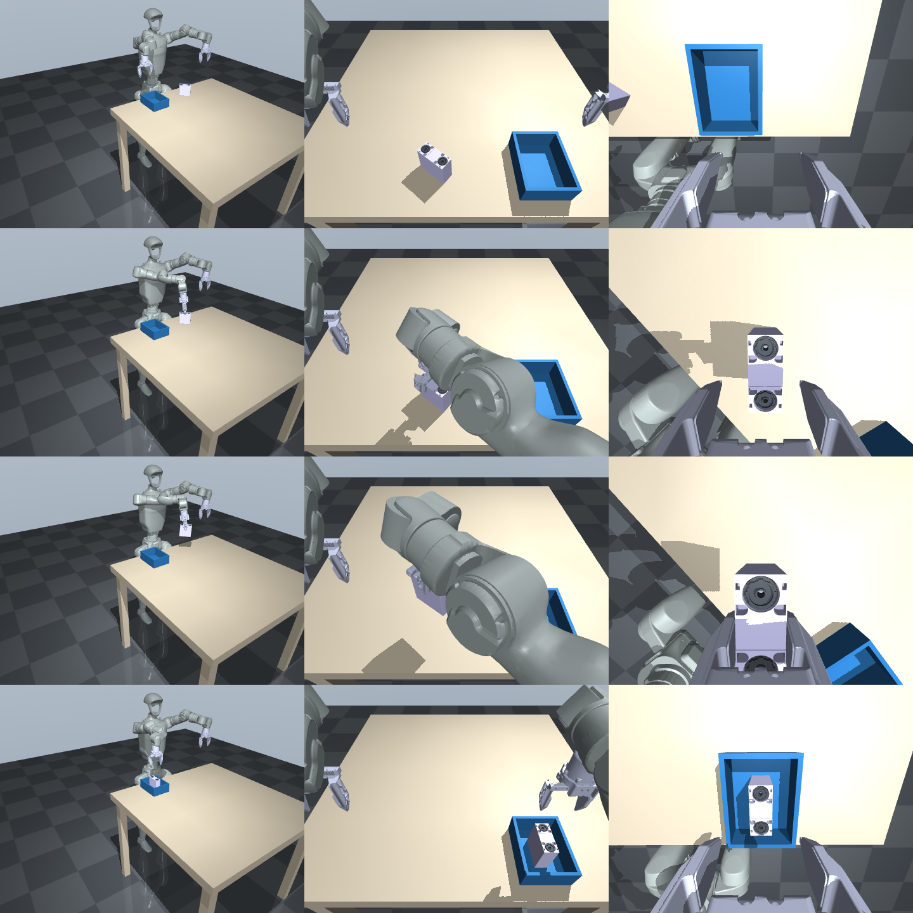

# MuJoCo-Szene: G1 am Tisch – Reagent Kit in die Box

Eine MuJoCo-Simulationsumgebung zum Sammeln von Trainingsdaten (Imitation Learning / VLA-Fine-Tuning).


*Spalten: Übersicht, Kopfkamera, rechte Handgelenkkamera. Zeilen: Start, Griff, Transport, Ablage.*

## Inhalt der Szene

| Objekt | Verhalten |
|---|---|
| **Unitree G1 + Dex1-Greifer** | steht vor dem Tisch (Becken fixiert auf 0,79 m, Beine/Taille starr). Beide Arme (je 7 Gelenke) und beide Greifer haben Positionsregler. |
| **Tisch** | 0,94 × 0,96 m, Höhe 0,75 m |
| **Box** (blau, offen) | **immer an derselben Stelle**: (x 0,32 m, y −0,20 m), rechts vor dem Roboter. Innen 15 × 11 cm, 6 cm hoch. |
| **Reagent Kit** | Original-Roche-CAD (81,5 × 34,5 × 81,4 mm), frei beweglich, 100 g. **Bei jedem Reset neue Zufallspose**: x ∈ [0,28; 0,37] m, y ∈ [−0,08; 0,08] m, Gierwinkel ∈ [−180°; 180°]. |
| **Kameras** | `head_cam` (D435-Position laut G1-URDF), `left_wrist_cam`, `right_wrist_cam`, `overview`, `front` |

Physik: Zeitschritt 2 ms, Steuerung 50 Hz, elliptische Reibkegel, `noslip_iterations=5`, Schwerkraftvorsteuerung für Arme und Finger. Diese Einstellungen stammen aus dem Kontaktprüfstand (`Simulation/contact-lab`).

## Schnellstart

```bash
python -m venv .venv
.venv/Scripts/pip install -r requirements.txt        # macOS/Linux: .venv/bin/pip
.venv/Scripts/python view_scene.py --demo             # Viewer: Demonstrator greift wiederholt
.venv/Scripts/python collect_data.py --episodes 50 --out data/run01
```

Im Viewer setzt die Taste `R` eine neue Zufallspose für das Kit. Mit den Schiebereglern im Control-Panel lassen sich die Gelenke direkt bewegen.

## Eigene Policy / Teleoperation anschliessen

```python
from roche_env import RocheKitBoxEnv
env = RocheKitBoxEnv(render=True)        # Kamerabilder in obs['images']
obs = env.reset(seed=42)                 # Box fest, Kit zufällig
for t in range(500):
    action = my_policy(obs)              # 16 Werte: [L-Arm 7, L-Greifer, R-Arm 7, R-Greifer]
    obs, info = env.step(action)         # info['success'] = Kit steht in der Box
```

Die Aktionen sind absolute Gelenk-Sollwerte in rad; für die Greifer gilt ein Wert in m für beide Finger (`GRIP_OPEN = 0.012`, `GRIP_CLOSE = -0.014`). Diese Belegung entspricht der Gelenkreihenfolge des echten G1 mit Dex1. Ein Quest-Teleop-Adapter kann deshalb dieselben Sollwerte senden.

## Datenformat (`collect_data.py`)

Pro Episode wird eine HDF5-Datei geschrieben, im Stil von ALOHA/ACT:

```
/action                          (T, 16) float32
/observations/qpos               (T, 16)
/observations/qvel               (T, 16)
/observations/kit_pose           (T, 7)   xyz + Quaternion wxyz (privilegiert: nur für Labels/Auswertung)
/observations/images/<kamera>    (T, 240, 320, 3) uint8, gzip
attrs: seed, success, kit_start, fps=50, language_instruction
```

Die Daten sind reproduzierbar: Gleicher Seed ergibt dieselbe Kitpose. Standardmässig werden nur erfolgreiche Episoden gespeichert, mit `--keep-failures` auch die anderen. Eine Episode mit Bildern hat ca. 50 MB.

## Demonstrator (`scripted_expert.py`)

Ein **skriptbasierter** Greifablauf, kein gelerntes Modell: Er fährt über das Kit, greift die schmale Seite, hebt an, fährt über die Box, setzt ab und öffnet. Er arbeitet nur mit Gelenk-Sollwerten, wie es auch ein Teleoperator tun würde, also ohne Teleportieren oder Festschweissen. Die IK erlaubt eine gekippte Hand, weil der G1 bei 0,75 m Tischhöhe senkrecht von oben nur einen kleinen Bereich erreicht.

**Gemessen** (MuJoCo 3.6.0, Windows): 38 von 40 Zufallsepisoden erfolgreich (Seeds 100–139, ca. 1,5 s Rechenzeit pro Episode ohne Bilder). Details und Fehlversuche stehen in `validation.json`.

## Grenzen / bewusst offen

- Das Becken ist fixiert, es gibt keine Gleichgewichtsregelung. Der „stehende“ Roboter ist also kinematisch gestützt. Für Laufen bleibt die Isaac-Szene zuständig.
- Kit-Kollision = konvexe Hülle des Hauptkörpers; Masse 100 g, Reibung 1,1 sind Annahmen. Regler-Gains, Dämpfung und Kontaktparameter sind **nicht** am echten G1/Dex1 identifiziert.
- Der Zufallsbereich des Kits ist auf den Bereich begrenzt, den der rechte Arm sicher erreicht. Für Tests der Generalisierung kann man `KIT_X_RANGE`/`KIT_Y_RANGE` in `roche_env.py` erweitern.
- Keine Domain-Randomisierung von Licht, Farben oder Kamerapose (nächster sinnvoller Schritt vor Sim-to-Real).
- Die Erfolge des Demonstrators sind Simulationsergebnisse. Sie sagen nichts über die Erfolgsquote am echten Roboter aus.

## Neu bauen

`python build_scene.py` erzeugt `scene.xml` aus `assets/`. Im privaten Repo werden die Assets dabei aus `Projectboard/training-demo/assets` aktualisiert. Szenenmasse stehen oben in `build_scene.py`. Wenn man sie ändert, muss man `roche_env.py` (BOX_CENTER usw.) anpassen.

## Quellen / Lizenzen

- G1-URDF und Meshes: `unitreerobotics/unitree_ros`, Commit `15ebe53`, BSD-3 (`assets/g1/LICENSE-Unitree.txt`, `provenance.json`).
- Reagent-Kit-Geometrie: Original-Roche-CAD; Veröffentlichung vom Projektinhaber freigegeben (26.10.2026).
